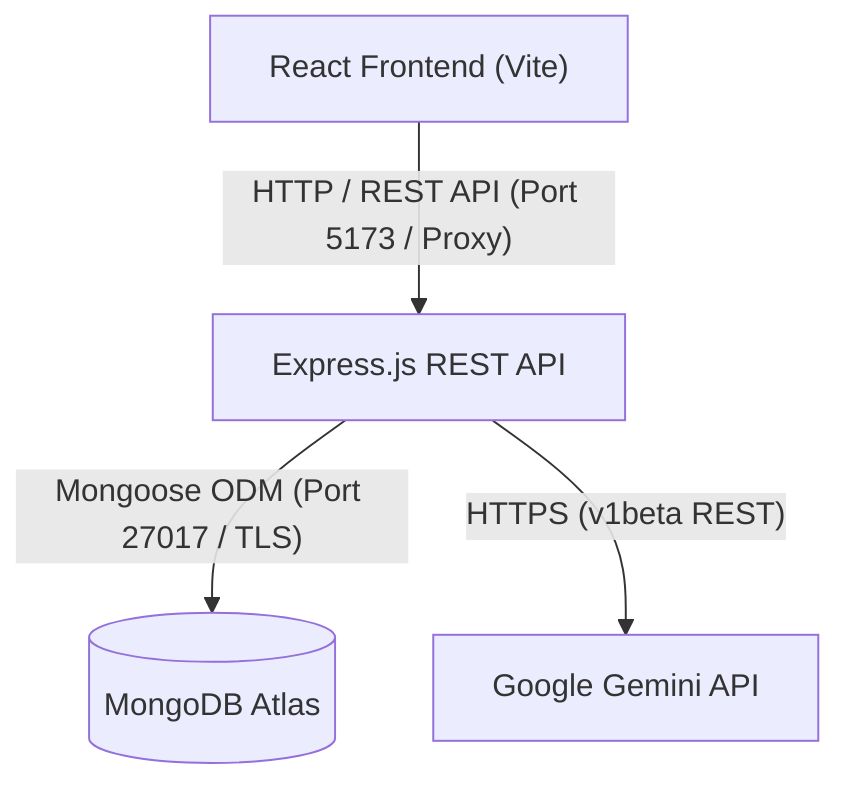

# Velox AI: AI Chatbot

Velox AI is a full-stack conversational AI application built on the MERN stack (MongoDB, Express.js, React, Node.js). It provides a responsive chat interface powered by the Google Gemini API with conversational memory, multi-turn context sanitization, persistent conversation management in MongoDB Atlas, and error handling.

---

## Project Overview

Velox AI delivers a chat experience with real-time AI responses, full persistence across browser sessions and server restarts, and a user interface modeled after modern AI assistant platforms. 

Key capabilities include:
- Real-time interaction with Google Gemini models optimized for low latency.
- Full multi-turn conversation memory with automated role-alternation sanitization.
- Persistent conversation threads and message logs stored in MongoDB Atlas via Mongoose.
- Resilient backend architecture that enforces data persistence and returns standard HTTP status codes.
- Fluid, responsive user interface featuring conversation history grouping, suggestion cards, auto-expanding composer, and keyboard navigation.

---

## Features

- **Conversational AI Interaction**: Generates contextual responses using Google Gemini models with an 8-second execution timeout to minimize latency.
- **Persistent Chat History**: Stores all user messages and assistant completions in MongoDB Atlas. History is retrieved across page refreshes and server restarts.
- **Conversation Thread Management**: Create new conversation threads, view organized conversation lists grouped by recency (Today and Previous 7 Days), and permanently delete threads with cascading message cleanup.
- **Dynamic Welcome Screen**: Interactive starting view with curated starter prompts that populate the composer and start a conversation with a single click.
- **Robust Error Handling**: Explicit 503 Service Unavailable responses when the database connection is lost, preventing silent data drops or inconsistent memory states.
- **Adaptive Frontend Design**: Responsive layout with a collapsible sidebar drawer for mobile viewports, dynamic viewport height (`100dvh`) support, and auto-scrolling message views.
- **IME-Safe Composer**: Multiline text area supporting Shift+Enter for newlines and Enter to submit, with input-method-editor (IME) guards to prevent accidental submissions during character composition.
- **System Health Diagnostics**: Dedicated `/api/health` endpoint reporting server uptime, MongoDB readyState, storage mode status, and active AI provider configuration.

---

## Technology Stack

### Frontend
- **Framework**: React 18 (Functional components, Hooks)
- **Tooling & Bundling**: Vite 6
- **Styling**: Vanilla CSS with modern flexbox, CSS Grid, custom scrollbar styling, and dynamic viewport units
- **HTTP Client**: Native browser Fetch API with error handling and configurable base URLs

### Backend
- **Runtime**: Node.js (ES Modules syntax)
- **Web Framework**: Express.js 4
- **Database ODM**: Mongoose 8
- **HTTP Middleware**: CORS (Cross-Origin Resource Sharing), Morgan (HTTP request logging)
- **Environment Management**: Dotenv

### Database & External Services
- **Database**: MongoDB Atlas (Cloud Database)
- **AI Provider**: Google Gemini API (`gemini-3.5-flash-lite`, with fallback to `gemini-flash-lite-latest`)
- **Secondary AI Provider Support**: OpenAI API (`gpt-3.5-turbo`) supported via configuration

---

## Project Architecture

The application follows a client-server architecture with separation between representation, business logic, data persistence, and external AI provider communications.



### Request Flow
1. **User Prompt**: The user submits a prompt via the React frontend.
2. **Persistence (User Turn)**: Express receives the request, verifies MongoDB connection readiness, and saves the user prompt as a `Message` document linked to the `Conversation`.
3. **Context Assembly**: The backend retrieves recent message history (up to the last 8 turns), converts them into Gemini-compatible content structures, and validates turn alternation (`user` followed by `model`).
4. **AI Generation**: The payload is dispatched to the Gemini API with an 8000ms timeout.
5. **Persistence (Assistant Turn)**: The generated completion is saved to MongoDB as an assistant `Message` document, the parent `Conversation` timestamp is updated, and the response is returned to the client.
6. **UI Update**: The frontend appends the assistant message and updates the sidebar thread listing.

---

## Prerequisites

Ensure the following tools and services are available before running the application:

- **Node.js**: Version 18.0.0 or higher (Node.js 20+ recommended).
- **npm**: Version 9.0.0 or higher.
- **MongoDB Atlas Account**: An active MongoDB Atlas cluster URI or a local MongoDB server (version 6.0+).
- **Google Gemini API Key**: A valid API key obtained from Google AI Studio.

---

## Project Structure

```
chatbot/
├── package.json                 # Monorepo scripts for concurrent development
├── README.md                    # Project documentation
├── .env.example                 # Example environment variables reference
├── backend/
│   ├── package.json             # Backend dependencies and startup scripts
│   ├── .env.example             # Backend environment template
│   └── src/
│       ├── server.js            # Server entrypoint and port binding
│       ├── app.js               # Express application configuration and middleware
│       ├── config/
│       │   └── db.js            # MongoDB connection manager with retry logic
│       ├── controllers/
│       │   ├── conversation.controller.js  # Thread management and retrieval logic
│       │   └── message.controller.js       # Message persistence and AI dispatch
│       ├── models/
│       │   ├── conversation.model.js       # Mongoose Conversation schema
│       │   └── message.model.js            # Mongoose Message schema
│       ├── routes/
│       │   ├── conversation.routes.js      # REST API route declarations
│       │   └── health.routes.js            # System health and status endpoint
│       └── services/
│           └── ai.service.js               # Gemini integration, context formatter, fallback
└── frontend/
    ├── package.json             # Frontend dependencies and Vite build scripts
    ├── vite.config.js           # Vite development server and API proxy config
    ├── index.html               # Single page HTML entrypoint
    └── src/
        ├── main.jsx             # React DOM root entrypoint
        ├── App.jsx              # Application state container and layout coordinator
        ├── index.css            # Base stylesheet, variables, and typography
        ├── App.css              # Layout containers, sidebar, and composer styles
        ├── api/
        │   └── chatApi.js       # HTTP client for backend REST endpoints
        └── components/
            ├── Sidebar.jsx      # Conversation thread drawer and history list
            ├── ChatWindow.jsx   # Message stream view and empty state switcher
            ├── WelcomeScreen.jsx# Interactive greeting and suggestion prompt cards
            ├── MessageItem.jsx  # User and assistant message bubble rendering
            └── MessageComposer.jsx # Text input, character handling, and submit triggers
```

---

## Environment Variables

All sensitive values must be configured via environment variables. Create a `.env` file in the `backend/` directory using the provided `backend/.env.example` as a template.

### Backend Configuration (`backend/.env`)

| Variable Name | Required | Default | Description |
|---|---|---|---|
| `PORT` | No | `5000` | Port on which the Express HTTP server listens. |
| `NODE_ENV` | No | `development` | Environment mode (`development` or `production`). |
| `MONGODB_URI` | Yes | None | MongoDB Atlas connection string with authenticated credentials and database name. |
| `GEMINI_API_KEY` | Yes | None | API key from Google AI Studio for Gemini generation calls. |
| `OPENAI_API_KEY` | No | None | Optional API key used as a secondary fallback if Gemini is unreachable. |

### Frontend Configuration (`frontend/.env`)

| Variable Name | Required | Default | Description |
|---|---|---|---|
| `VITE_API_BASE_URL` | No | `http://localhost:5000/api` | Base URL for REST API calls. If omitted in local development, Vite proxies `/api` requests to `http://localhost:5000`. |

---

## Installation and Setup

### 1. Clone the Repository
```bash
git clone <repository-url>
cd chatbot
```

### 2. Install Dependencies
Run the unified installation command from the project root to install dependencies for the root coordinator, backend, and frontend:
```bash
npm run install:all
```

Alternatively, install dependencies manually in each workspace:
```bash
# Root workspace
npm install

# Backend workspace
cd backend
npm install
cd ..

# Frontend workspace
cd frontend
npm install
cd ..
```

### 3. Configure Environment Variables
Copy the example environment template into the `backend/` folder:
```bash
# Git Bash
cp backend/.env.example backend/.env

# On Windows PowerShell
Copy-Item backend/.env.example backend/.env
```
Edit `backend/.env` with your actual MongoDB Atlas connection string and Google Gemini API key. Ensure the MongoDB connection string uses standard URL encoding for usernames and passwords containing special characters.

---

## Running Locally

### Option A: Run Backend and Frontend Concurrently (Recommended)
From the project root:
```bash
npm run dev
```
This starts:
- Express Backend on `http://localhost:5000` (monitored with `nodemon`).
- Vite Frontend on `http://localhost:5173` (with hot module replacement).

### Option B: Run Services in Separate Terminals

#### Terminal 1: Backend
```bash
cd backend
npm run dev
```

#### Terminal 2: Frontend
```bash
cd frontend
npm run dev
```

### Verification URLs
- **Frontend Application**: `http://localhost:5173`
- **Backend Health Check**: `http://localhost:5000/api/health`
- **Backend Conversation Index**: `http://localhost:5000/api/conversations`

---

## API Endpoints

All application routes are prefixed with `/api`.

### 1. Health Status
- **Method**: `GET`
- **Path**: `/api/health`
- **Purpose**: Verify operational status, database connectivity, and configured AI services.
- **Response `200 OK`**:
```json
{
  "status": "healthy",
  "uptime": 128.45,
  "timestamp": "2026-10-19T18:00:00.000Z",
  "database": {
    "status": "connected",
    "readyState": 1,
    "storageMode": "mongodb"
  },
  "ai": {
    "provider": "google-gemini",
    "model": "gemini-3.5-flash-lite",
    "hasGeminiKey": true,
    "hasOpenAiKey": false
  }
}
```

### 2. List Conversations
- **Method**: `GET`
- **Path**: `/api/conversations`
- **Purpose**: Retrieve all stored conversation threads ordered by most recently updated.
- **Response `200 OK`**:
```json
{
  "success": true,
  "data": [
    {
      "_id": "67b4f8a12c8b417e29a3e110",
      "title": "System Architecture Optimization",
      "createdAt": "2026-10-19T17:30:00.000Z",
      "updatedAt": "2026-10-19T17:35:12.000Z"
    }
  ]
}
```
- **Response `503 Service Unavailable`** (when MongoDB is disconnected):
```json
{
  "success": false,
  "message": "Database is not connected. In-memory fallback is disabled to protect data persistence."
}
```

### 3. Create Conversation
- **Method**: `POST`
- **Path**: `/api/conversations`
- **Purpose**: Initialize a new conversation thread.
- **Request Body** (optional):
```json
{
  "title": "New Conversation"
}
```
- **Response `201 Created`**:
```json
{
  "success": true,
  "data": {
    "_id": "67b4f9992c8b417e29a3e115",
    "title": "New Conversation",
    "createdAt": "2026-10-19T17:40:00.000Z",
    "updatedAt": "2026-10-19T17:40:00.000Z"
  }
}
```

### 4. Get Conversation Messages
- **Method**: `GET`
- **Path**: `/api/conversations/:conversationId/messages`
- **Purpose**: Fetch chronological messages belonging to a specific conversation.
- **Response `200 OK`**:
```json
{
  "success": true,
  "data": [
    {
      "_id": "67b4fa012c8b417e29a3e120",
      "conversationId": "67b4f9992c8b417e29a3e115",
      "sender": "user",
      "text": "What are microservices?",
      "createdAt": "2026-10-19T17:41:00.000Z"
    },
    {
      "_id": "67b4fa052c8b417e29a3e121",
      "conversationId": "67b4f9992c8b417e29a3e115",
      "sender": "assistant",
      "text": "Microservices are an architectural pattern...",
      "createdAt": "2026-10-19T17:41:02.000Z"
    }
  ]
}
```
- **Response `404 Not Found`**:
```json
{
  "success": false,
  "message": "Conversation not found"
}
```

### 5. Send Message
- **Method**: `POST`
- **Path**: `/api/conversations/:conversationId/messages`
- **Purpose**: Submit a user prompt, persist it, execute the AI completion, and persist the assistant reply.
- **Request Body**:
```json
{
  "text": "Explain indexing in MongoDB"
}
```
- **Response `201 Created`**:
```json
{
  "success": true,
  "data": {
    "userMessage": {
      "_id": "67b4fb102c8b417e29a3e130",
      "conversationId": "67b4f9992c8b417e29a3e115",
      "sender": "user",
      "text": "Explain indexing in MongoDB",
      "createdAt": "2026-10-19T17:45:00.000Z"
    },
    "assistantMessage": {
      "_id": "67b4fb122c8b417e29a3e131",
      "conversationId": "67b4f9992c8b417e29a3e115",
      "sender": "assistant",
      "text": "Indexes in MongoDB support the efficient execution of queries...",
      "createdAt": "2026-10-19T17:45:01.800Z"
    }
  }
}
```

### 6. Delete Conversation
- **Method**: `DELETE`
- **Path**: `/api/conversations/:conversationId`
- **Purpose**: Delete a conversation and all linked messages via cascading deletion.
- **Response `200 OK`**:
```json
{
  "success": true,
  "message": "Conversation and associated messages deleted successfully",
  "data": {
    "_id": "67b4f9992c8b417e29a3e115"
  }
}
```

---

## AI API Integration

The AI integration layer is implemented in `backend/src/services/ai.service.js`.

### Primary Engine: Google Gemini API
- **Endpoint**: Google Gemini `v1beta` REST API (`generateContent`).
- **Primary Model**: `gemini-3.5-flash-lite`.
- **Secondary Model Fallback**: `gemini-flash-lite-latest`.
- **Network Timeout**: Uses `AbortSignal.timeout(8000)` (8 seconds) to terminate hanging socket connections and protect response latency.
- **History Sanitization**:
  - The service takes up to the 8 most recent historical turns.
  - Formats sender roles: `user` maps to `user`, `assistant` maps to `model`.
  - Enforces Gemini's strict turn-taking contract: adjacent identical roles are consolidated or filtered to ensure strict alternation (`user` -> `model` -> `user`).
  - Ensures the conversation starts with a `user` turn.

### Fallback Execution Strategy
1. **Google Gemini**: Attempt generation with `gemini-3.5-flash-lite`. If that fails or times out, attempt with `gemini-flash-lite-latest`.
2. **OpenAI Service**: If Gemini credentials are missing or the API encounters an unrecoverable failure and `OPENAI_API_KEY` is present, the service falls back to `gpt-3.5-turbo`.
3. **Local Simulation**: If neither key is configured or both providers fail, an intelligent mock fallback activates so development workflows remain unblocked. Every response payload clearly indicates the source provider and model in metadata.

---

## MongoDB Integration

Data persistence is managed using Mongoose with MongoDB Atlas.

### Schemas

#### Conversation Schema (`backend/src/models/conversation.model.js`)
- `title`: String, required, trimmed, default: `"New Conversation"`.
- `metadata`: Flexible object for configuration tags.
- `timestamps`: Automatic `createdAt` and `updatedAt`.

#### Message Schema (`backend/src/models/message.model.js`)
- `conversationId`: `mongoose.Schema.Types.ObjectId`, reference to `Conversation`, required, indexed.
- `sender`: String enum (`['user', 'assistant', 'system']`), required.
- `text`: String, required, trimmed.
- `metadata`: Object storing token metrics, latency, and provider signatures.
- `timestamps`: Automatic `createdAt` and `updatedAt`.

### Connection Lifecycle & Resilience
- **Server Selection Timeout**: 5000ms timeout prevents application hangs during network unreachable states.
- **Background Reconnection**: Automatic reconnection handler with exponential backoff retries connecting every 10 seconds if a disconnect occurs.
- **Strict Persistence Rule**: The backend validates that `mongoose.connection.readyState === 1` before performing CRUD operations. If disconnected, it rejects requests with `503 Service Unavailable` rather than falling back to in-memory storage, preventing silent data loss.
- **Cascading Deletes**: Deleting a conversation triggers a parallel `Message.deleteMany({ conversationId })` operation to prevent orphaned records in MongoDB.

---

## Error Handling

The application enforces consistent error handling across the stack:

- **Database Disconnection (503)**: Controllers check database readiness before performing queries. If disconnected, a standard 503 response is returned with a clear error message.
- **Validation Errors (400)**: Missing fields (e.g., empty prompt strings) or malformed MongoDB ObjectIds return 400 Bad Request with actionable descriptions.
- **Not Found (404)**: Accessing a non-existent conversation returns a 404 response.
- **AI Latency & Timeouts (504 / Fallback)**: The AI service isolates model execution within an 8-second timeout window, preventing blocked threads.
- **Frontend Feedback**: The frontend captures non-2xx status codes and renders an inline notification banner in the chat window, preventing application crashes.

---

## Deployment

### Frontend Production Build
To create an optimized production build of the React frontend:
```bash
npm run build:frontend
```
This generates production-ready static assets in `frontend/dist/`. The assets can be served by Nginx, Cloudflare Pages, Vercel, Netlify, or directly by the Express backend.

### Production Execution
1. Set `NODE_ENV=production` in the backend environment.
2. In production, configure `VITE_API_BASE_URL` in `frontend/.env` to point to the production backend API domain (e.g., `https://api.yourdomain.com/api`).
3. Ensure backend CORS configuration (`backend/src/app.js`) permits the production frontend origin.
4. Launch the production server:
```bash
npm run start:backend
```

---

## Security Considerations

- **Credential Isolation**: Secrets such as `GEMINI_API_KEY` and `MONGODB_URI` are loaded exclusively through environment variables. They are excluded from version control via `.gitignore`.
- **Credential Masking**: The database initialization routine strips out authentication passwords before printing connection logs, ensuring logs never expose database credentials.
- **Input Sanitization**: Message inputs are trimmed and validated before being written to database documents or forwarded to external AI APIs.
- **CORS Constraints**: Backend routes specify permitted origin headers to prevent unauthorized cross-origin requests.

---

## Troubleshooting

### MongoDB Atlas Connection Issues
- **Error**: `MongooseServerSelectionError: connection timed out` or `bad auth / Authentication failed`.
  - **Resolution**:
    1. Confirm that your current IP address is whitelisted in MongoDB Atlas under **Network Access** (or set `0.0.0.0/0` for temporary testing).
    2. Check that the database user credentials in `backend/.env` have read/write access to the targeted database.
    3. Ensure special characters in your database password are properly URL-encoded (e.g., `@` encoded as `%40`).

### SSL Handshake / Alert 80 Errors
- **Error**: `SSL routines:ssl3_read_bytes:tlsv1 alert internal error` or `SSL alert number 80`.
  - **Resolution**: This error indicates that the client IP is blocked by the MongoDB Atlas IP Access List or an institutional firewall/VPN is intercepting TLS traffic. Whitelist your public IP in MongoDB Atlas under **Security -> Network Access**.

### Port Conflicts
- **Error**: `EADDRINUSE: address already in use :::5000`.
  - **Resolution**: Change the `PORT` variable in `backend/.env` to an alternate port (such as `5001`), and update `frontend/vite.config.js` or `frontend/.env` with the new target port.

### AI Generation Delays
- **Symptom**: Chat response takes longer than expected.
  - **Resolution**: Velox AI defaults to `gemini-3.5-flash-lite`, the fastest model for real-time applications. If you notice latency spikes, check your network connection to Google API servers or confirm your Gemini API key is valid and not hitting rate limits.
